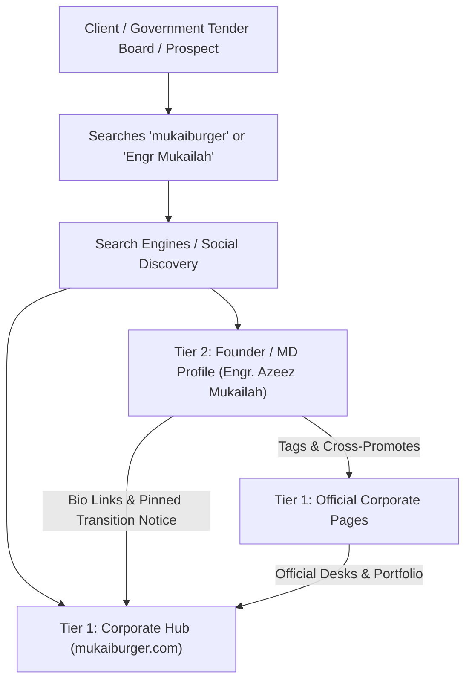

# Mukaiburger Engineering Nigeria Limited
## Brand, Search & Digital Footprint Alignment Plan

**Prepared for:** Executive Management & Partners  
**Entity:** Mukaiburger Engineering Nigeria Limited (CAC RC: 1300720)  
**Primary Domain:** [https://www.mukaiburger.com](https://www.mukaiburger.com)  
**Date:** October 2026  

---

## 1. Executive Summary & Objective

As Mukaiburger Engineering formalizes its online corporate presence, a temporary alignment gap exists between the founder's longstanding personal social media accounts, the historical development domain (`mukaiburger.vercel.app`), and the newly launched corporate website and official media handles.

This document outlines the **Two-Tier Brand Architecture** designed to eliminate search confusion, preserve and leverage Engr. Azeez Mukailah Matthew’s established professional reputation, and accelerate Google’s indexing of the official corporate properties without disrupting past business relationships.

---

## 2. Current Situation & Root Cause Analysis

When searching for **"mukaiburger"** on Google today:
1. **Google Index Delay:** Search engines rank results based on age, backlinks, and crawl history. The founder’s personal Facebook/social accounts and the temporary Vercel preview domain have been active online for months and years; consequently, Google has deeply cached them.
2. **Freshness of Corporate Assets:** The official domain `mukaiburger.com` and the dedicated corporate social accounts are brand-new and still being crawled.
3. **Account Convergence:** Historically, Engr. Mukailah used his personal account for both personal life and company project updates, creating a single digital footprint that Google recognizes as the primary entity.

> [!IMPORTANT]
> This is a standard transition phase for expanding engineering firms. In civil engineering and construction, having an existing founder footprint with years of project documentation is a **major competitive asset**, not a liability. We do not need to erase it—we need to direct it.

---

## 3. The Core Strategy: The Two-Tier Architecture

In Nigerian civil engineering, public infrastructure, and private real estate, clients (state governments, corporate bodies, high-net-worth developers) hire **both** the registered corporate contractor and the licensed engineer behind it.

Rather than competing with the founder’s personal presence, we structure our footprint into two complementary tiers:



### Tier 1: The Corporate Entity (Official Channels)
* **Target Audience:** Procurement officers, corporate developers, government tender boards, institutional partners.
* **Tone:** Institutional, formal, authoritative, corporate.
* **Content Focus:** Completed infrastructure projects, corporate compliance (CAC, COREN), HSE standards, bid announcements, formal tenders.
* **Primary Channels:**
  * **Website:** `https://www.mukaiburger.com`
  * **General Enquiries:** `contact@mukaiburger.com`
  * **Projects & Site Work:** `projects@mukaiburger.com`
  * **Tenders & Bids:** `tenders@mukaiburger.com`
  * **Corporate Social Media:** Official handles linked on the website.

### Tier 2: The Founder / Managing Director (Personal Brand)
* **Target Audience:** Longstanding colleagues, industry peers, prospective private clients who value personal rapport.
* **Tone:** Professional, authentic, expert, on-site leadership.
* **Content Focus:** On-site problem solving, engineering insights, structural commentary, thought leadership, team achievements.
* **Function:** Serves as an **executive lead funnel** sending authority and traffic directly to Tier 1.

---

## 4. Step-by-Step Action Plan

### Step 1: Automated Vercel Permanent Redirect (COMPLETED)
* **Status:** **LIVE & ACTIVE**
* **Technical Action:** A permanent HTTP 308 redirect was deployed on the codebase.
* **Result:** Any user or search engine crawler visiting `mukaiburger.vercel.app` is now immediately forwarded to `https://www.mukaiburger.com`. Google will replace the `.vercel.app` listing with `mukaiburger.com` during subsequent index refreshes.

---

### Step 2: Update Founder's Social Media Bios
Update the "Bio" or "About" section across Engr. Mukailah's personal accounts (Facebook, LinkedIn, Instagram) to clearly establish his executive role and point to the corporate office.

#### Recommended Bio Copy (Plug-and-Play):
```text
Engr. Azeez Mukailah Matthew (MD/CEO)
Founder & Managing Director, Mukaiburger Engineering Nigeria Limited (RC 1300720).
Civil & Structural Engineering | Project Delivery | Infrastructure

🌐 Official Website: https://www.mukaiburger.com
🏢 Official Corporate Page: [Insert handle of new company page]
📩 Corporate Enquiries: contact@mukaiburger.com
```

---

### Step 3: Publish a Pinned "Corporate Transition" Announcement
Publish a pinned post at the top of the founder’s personal profiles. Any visitor landing on his page will immediately see that the business has formalized its dedicated corporate channels.

#### Recommended Pinned Post Copy:
```text
Official Notice: Mukaiburger Corporate Transition

Over the past decade, Mukaiburger Engineering Nigeria Limited has delivered trusted civil and structural engineering solutions across Nigeria.

As part of our strategic corporate expansion, all official company tenders, project updates, procurement opportunities, and institutional enquiries are now hosted on our dedicated corporate platforms:

🌐 Official Web Portal: https://www.mukaiburger.com
📩 General Enquiries: contact@mukaiburger.com
📩 Project Inquiries: projects@mukaiburger.com
📩 Tenders & Procurement: tenders@mukaiburger.com
🏢 Follow Our Official Company Page: [Tag new company page]

This personal profile will continue to feature my on-site engineering insights, project supervision commentary, and professional updates. 

Thank you for your continued trust and partnership as we build the future.
```

---

### Step 4: Quick Privacy Housekeeping (5–10 Minutes)
To ensure the founder's account looks sharp and executive-ready:
1. **Personal / Family Posts:** Review older personal/family updates (birthdays, private gatherings) and change the post audience from **Public** to **Friends Only**.
2. **Engineering & Construction Posts:** Keep all construction photos, foundation pours, site walkthroughs, and structural milestones set to **Public**. These provide undeniable proof of experience and bolster trust.

---

### Step 5: Accelerate Google Indexing
Rather than waiting weeks for Googlebot’s natural crawl cycles:
1. Open the [Google Search Console](https://search.google.com/search-console).
2. Add the property `https://www.mukaiburger.com` (verified via DNS TXT record or HTML tag).
3. Submit the live XML sitemap: `https://www.mukaiburger.com/sitemap.xml`.
4. Request indexing for the homepage `https://www.mukaiburger.com/`.

---

## 5. Expected Timeline & Search Engine Transition

| Timeframe | Expected Outcome |
| :--- | :--- |
| **Immediate (Day 0–1)** | All traffic hitting the old Vercel URL automatically redirects to `https://www.mukaiburger.com`. |
| **Day 2–5** | Founder's updated bio and pinned announcement resolve confusion for all inbound visitors and social searches. |
| **Week 1–2** | Googlebot processes the 308 redirect and sitemap submission; `mukaiburger.com` begins appearing as the primary search result. |
| **Day 30+** | The old Vercel link drops out of Google results completely. Searching "mukaiburger" displays `mukaiburger.com` at the top, followed by the official company pages and the founder's executive profile. |

---

## 6. Official Reference Desks

For all corporate documentation, letterheads, and public profiles, use only the verified desks:

* **Official Domain:** [https://www.mukaiburger.com](https://www.mukaiburger.com)
* **General Desk:** [contact@mukaiburger.com](mailto:contact@mukaiburger.com)
* **Projects Desk:** [projects@mukaiburger.com](mailto:projects@mukaiburger.com)
* **Tenders Desk:** [tenders@mukaiburger.com](mailto:tenders@mukaiburger.com)
