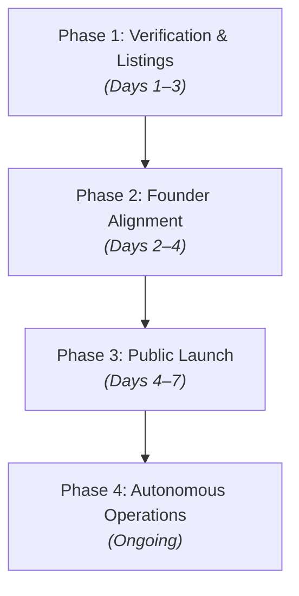

# Mukaiburger Engineering Nigeria Limited
## Post-Launch Master Roadmap & Action Blueprint

**Entity:** Mukaiburger Engineering Nigeria Limited (RC 1300720)  
**Official Portal:** [https://www.mukaiburger.com](https://www.mukaiburger.com)  
**Date:** October 2026  
**Scope:** Immediate to 30-Day Operational Plan  

---

## Roadmap Overview

---

## Phase 1: Claiming, Ownership & Technical Verification (Days 1–3)

### 1.1 Claim & Verify the Business Listing
You received an email about "claiming the listing" or website. This typically refers to **Google Business Profile (Google Maps)** or an established Nigerian business directory (e.g., VConnect, Yalwa, Finelib).

* **Why this is critical:** When prospective clients search "Mukaiburger" or "Civil Engineer near me", a verified Google Business listing shows an official corporate Knowledge Panel with your phone number, website link (`www.mukaiburger.com`), CAC registration, and reviews.
* **Step-by-step action:**
  1. Open the claim email you received and click the verification/claim link.
  2. If it is Google Business Profile, go to [google.com/business](https://www.google.com/business).
  3. Search for **"Mukaiburger Engineering Nigeria Limited"**.
  4. Select **Claim this business** or **Manage now**.
  5. Enter the official company details:
     * **Category:** Civil Engineer / Construction Company / Structural Engineer
     * **Website:** `https://www.mukaiburger.com`
     * **Email:** `contact@mukaiburger.com`
     * **Phone:** The official company line
  6. Complete the verification (via SMS, business email, or video of office/signage).

---

### 1.2 Submit Sitemap to Google Search Console
* **Goal:** Tell Google to replace the `.vercel.app` development URL and put `mukaiburger.com` at the top of search results immediately.
* **Step-by-step action:**
  1. Go to [search.google.com/search-console](https://search.google.com/search-console).
  2. Sign in with the primary company Google account.
  3. Select **Add Property** -> choose **URL prefix** -> enter `https://www.mukaiburger.com`.
  4. Verify ownership (the easiest method is adding the HTML meta tag or using DNS TXT record on Namecheap).
  5. In the left menu, click **Sitemaps**.
  6. Enter `sitemap.xml` in the submission box and click **Submit**. (The sitemap is already live and verified at `https://www.mukaiburger.com/sitemap.xml`).

---

## Phase 2: Zero-Friction Founder Alignment (Days 2–4)

To protect Engr. Mukailah from being disturbed by day-to-day social media management, you only need **one simple interaction** with him:
1. Provide the exact text for his personal bio update.
2. Establish a shared WhatsApp media drop where he drops site photos.

### Message to Send to Engr. Mukailah (Copy & Paste via WhatsApp):

> *"Good day, Engr. Mukailah. Trust site work is progressing well.*
> 
> *Quick update on the company branding: The official website is fully live at **www.mukaiburger.com**, along with our official email desks (contact@, projects@, tenders@) and our dedicated corporate social media pages.*
> 
> *To make sure your personal time is completely protected and you don't have to stress about managing social media, our team will handle 100% of the posting, marketing, and client inquiries through the new corporate accounts.*
> 
> *We only need two quick things from you:*
> 
> *1. **One-Time Bio Update:** Kindly update the bio on your personal Facebook / LinkedIn / Instagram to point visitors to the official company page. Here is the exact text you can just copy and paste:*
> 
> *Engr. Azeez Mukailah Matthew (MD/CEO)*  
> *Founder & MD, Mukaiburger Engineering Nigeria Ltd (RC 1300720)*  
> *Civil & Structural Engineering | Infrastructure*  
> *🌐 Official Website: https://www.mukaiburger.com*  
> *🏢 Company Page: @[Insert_New_Handle]*  
> *📩 Corporate Desk: contact@mukaiburger.com*  
> 
> *2. **Site Photos Pipeline:** Whenever you or the supervisors are on site, please snap 3 to 5 quick photos or videos of the active work (foundation, concrete pouring, rebar, finished levels) and drop them here on WhatsApp. No need to write captions or do any editing—our team will take them, format them professionally, and publish them to build our corporate portfolio.*
> 
> *Thank you, sir, for your leadership as we scale Mukaiburger to the next level."*

---

## Phase 3: Launch Announcements & Broadcasts (Days 4–7)

Once the profiles are ready, announce the official corporate portal to your network.

### 3.1 Client & Partner Announcement (WhatsApp Broadcast / Email)
Send this to existing clients, subcontractors, materials suppliers, and professional contacts:

> **Subject / Headline: Official Launch: Mukaiburger Engineering Corporate Web Portal**
> 
> *Dear Partners, Clients, and Colleagues,*
> 
> *We are pleased to announce the formal launch of Mukaiburger Engineering Nigeria Limited's official corporate digital portal:*
> 
> 🌐 **Website:** https://www.mukaiburger.com  
> 
> *Since our incorporation (CAC RC 1300720), our commitment has remained unwavering: delivering civil, structural, and infrastructure projects with rigorous engineering precision.*
> 
> *For streamlined operations, our direct communication desks are now live:*
> * 📩 **General Consultations:** contact@mukaiburger.com  
> * 📩 **Project Inquiries:** projects@mukaiburger.com  
> * 📩 **Tenders & Procurement:** tenders@mukaiburger.com  
> 
> *Follow our verified corporate updates:*  
> * LinkedIn: [Link]  
> * Instagram: [Link]  
> * Facebook: [Link]  
> 
> *Thank you for your ongoing partnership as we build durable infrastructure across Nigeria.*
> 
> **Mukaiburger Engineering Nigeria Limited**  
> *Precision in Engineering. Excellence in Delivery.*

---

### 3.2 First Post on the New Corporate Social Accounts
Publish this as the debut post on Instagram, Facebook, and LinkedIn:

> **Precision in Engineering. Excellence in Delivery.**
> 
> *Welcome to the official corporate page of Mukaiburger Engineering Nigeria Limited (CAC RC 1300720).*
> 
> *For over a decade, under the technical leadership of our Managing Director, Engr. Azeez Mukailah Matthew, we have delivered dependable civil engineering, structural construction, and infrastructure solutions across Nigeria.*
> 
> *From structural inception to final project delivery, our team combines technical expertise with disciplined execution to ensure every project meets the highest standards of safety, quality, and performance.*
> 
> 🌐 *Explore our capabilities and portfolio: https://www.mukaiburger.com*  
> 📩 *For project inquiries: projects@mukaiburger.com*  
> 📩 *For tender invitations & bids: tenders@mukaiburger.com*  
> 
> *#CivilEngineering #ConstructionNigeria #StructuralEngineering #Infrastructure #Mukaiburger #EngineeringExcellence #BuildingNigeria*

---

## Phase 4: Autonomous Weekly Content Engine (Ongoing)

Operate this routine independently without disturbing the founder:

| Day | Content Pillar | Post Description | Visual |
| :--- | :--- | :--- | :--- |
| **Tuesday** | **Active Site Progress** | Highlight work happening on an active site. Focus on precision, measurements, rebar, or concrete strength. | Raw site video or 3-photo carousel received from site. |
| **Thursday** | **Engineer / Leadership Spotlight** | Feature Engr. Mukailah's technical oversight (e.g., "Our MD on site inspecting foundation soil compaction"). | Photo of Engr. Mukailah in PPE reviewing blueprints or inspecting work. |
| **Saturday** | **Completed Milestone / Portfolio** | Before-and-after shot, completed structural frame, or finished building. Direct viewers to `www.mukaiburger.com/projects`. | Polished, clean photo of finished work. |

---

## Phase 5: Verification & Mailbox Routine

* **Check the 3 Corporate Mailboxes Daily / Every 2 Days:**
  * Log into Namecheap Webmail (`mail.mukaiburger.com` or private email portal).
  * Check `contact@mukaiburger.com`, `projects@mukaiburger.com`, and `tenders@mukaiburger.com`.
  * Ensure incoming contact form submissions from the website receive a professional acknowledgment within 24 hours.
